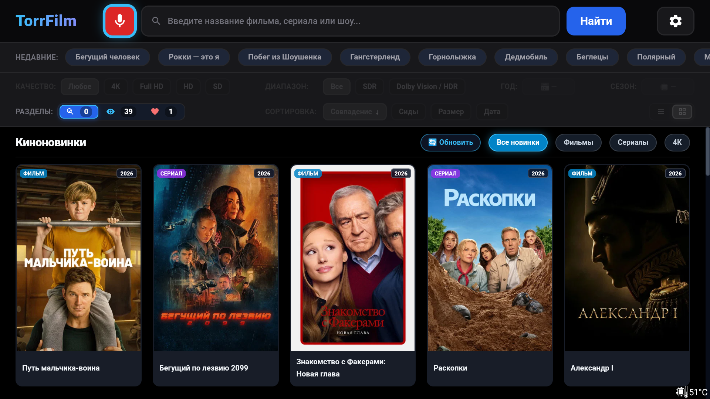
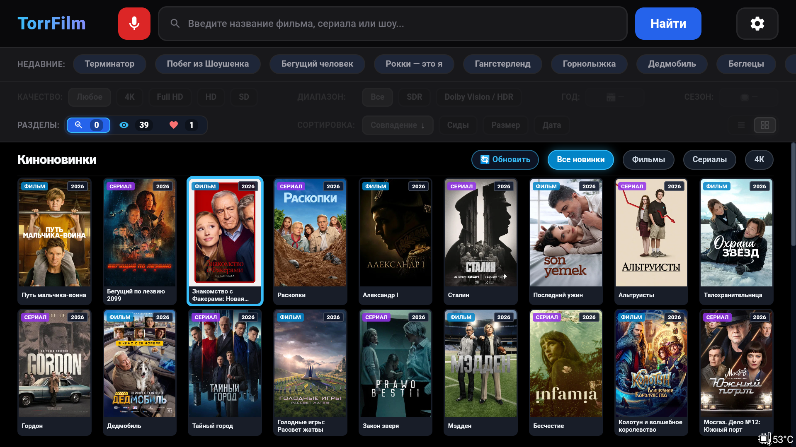
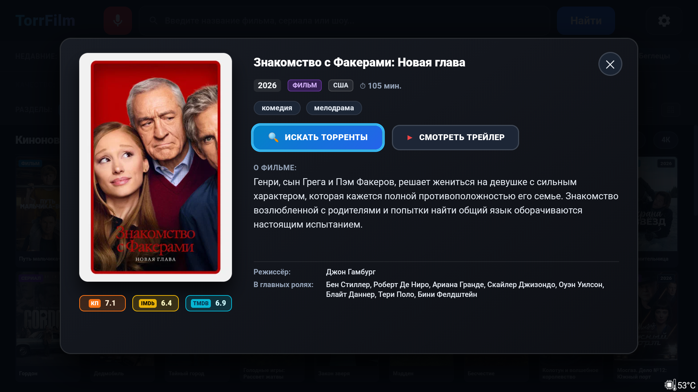
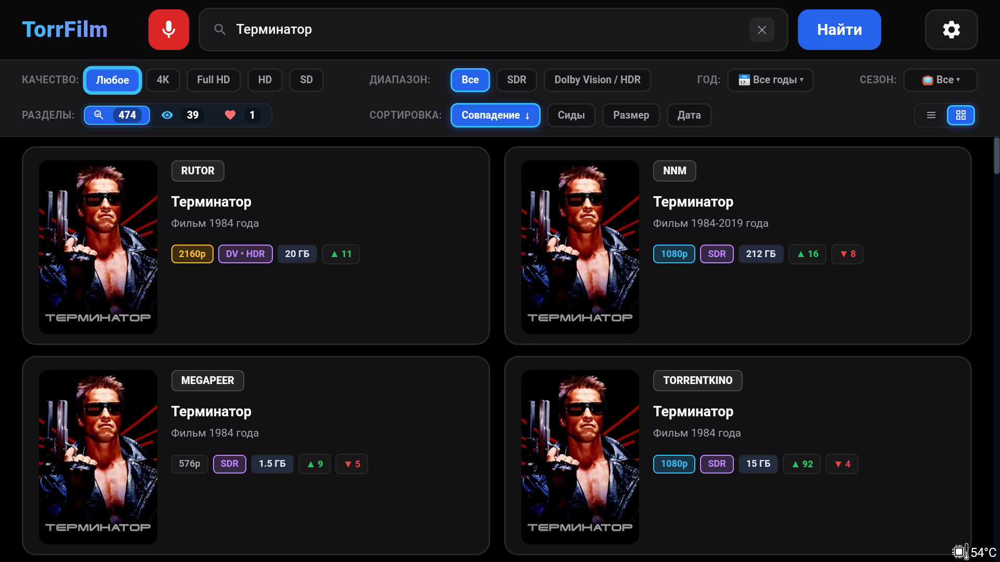

# TorrFilm (Android TV)

**Быстрый агрегатор и поисковик торрент-раздач для телевизоров, медиаприставок и проекторов на базе Android TV и Google TV.**

### 📥 [Скачать TorrFilm.apk (v1.0.5)](https://github.com/Yura1206/TorrFilm/releases/latest/download/TorrFilm.apk)
*(Прямая ссылка на загрузку актуальной версии)*

---

## 📺 О проекте

**TorrFilm** — специализированное приложение для комфортного поиска и онлайн-просмотра фильмов и сериалов с открытых торрент-трекеров на экранах телевизоров. 

Приложение изначально спроектировано для работы с пультом дистанционного управления (D-Pad), поддерживает голосовой ввод и связку с **TorrServe MatriX** для просмотра видеопотока без необходимости предварительного скачивания файлов на накопитель.

---

## 🚀 Что нового в версии 1.0.5

* **🎙️ Умное автоисправление и логика фокуса голосового поиска:**
  * Интеллектуальное исправление неточно распознанных голосовых запросов по базе кинопроизведений (сглаживание неточностей распознавания речи и опечаток).
  * Продвинутая нормализация запросов с поддержкой кириллицы, латиницы и смешанных тайтлов.
  * Улучшена логика фокуса пульта: во время активного поиска фокус надёжно удерживается на кнопке «Отменить поиск», при отмене возвращается к микрофону, а при успешной загрузке раздач автоматически переходит на фильтр качества («Любое»).
* **🎬 Плавная бесконечная подгрузка новинок («Киноновинки»):**
  * Бесконечная пагинация с упреждающей пакетной предзагрузкой постеров на 15–20 карточек вперёд — устранены задержки и пустые окна при быстром пролистывании зажатой кнопкой на пульте.
  * Мгновенное синхронное отображение витрины новинок и всего интерфейса при старте приложения (0ms).
* **📖 Модальное окно синопсиса и плавная карточка фильма:**
  * Добавлена кнопка «ЕЩЁ...», открывающая полный синопсис фильма/сериала в отдельном модальном окне с крупным, комфортным для ТВ шрифтом.
  * Устранены скачки интерфейса при открытии карточки фильма благодаря предварительному получению жанров, рейтингов Кинопоиск/IMDb, страны и длительности.
  * Оптимизированный тёмный градиентный фон карточки без лишней нагрузки на GPU ТВ-приставки.
* **🛡️ 3-уровневый каскад Edge-шлюзов и выбор каталога:**
  * Трёхуровневый каскад сетевой оптимизации: кастомный Cloudflare-шлюз + 2 резервных шлюза Supabase с мгновенным автоматическим переключением.
  * В настройках добавлен выбор источника новинок и постеров: открытые каталоги с независимым кешированием.
  * Расширенная встроенная диагностика сети в настройках с проверкой каждого узла и CDN.
* **✨ Улучшения интерфейса и адаптации (1080p и 720p):**
  * Пустая история поиска теперь отображается в виде аккуратной строки с равномерным распределением подсказок по всей ширине экрана.
  * Оптимизированы пропорции кнопки «Найти» и значка голосового ввода для разрешения 1080p.
  * Улучшена читаемость текста, отступы и вертикальное выравнивание плашек в режиме «Список» (построчный вид).

<b>Предыдущие версии (v1.0.4)</b>

* **🖥️ Поддержка 720p (HD) и переключение масштаба интерфейса:**
  * В настройки добавлен выбор режима отображения: **«Авто»**, **«Компактный (720p)»** и **«Стандартный (1080p)»**.
  * Полная адаптация всех компонентов под телевизоры и приставки с разрешением 720p (HD): пересчитаны размеры шрифтов, отступы, высоты карточек и модальных окон без обрезания элементов.
* **🏷️ Выбор стиля баннера для домашнего экрана ТВ:**
  * В настройках теперь можно выбрать стиль отображения приложения в лаунчере:
    * **«Стандартный»** — полноразмерный фирменный баннер 16:9 со встроенным логотипом и названием для официального Android TV / Google TV.
    * **«Адаптивный»** — раздельный фон и масштабируемый векторный значок для сторонних лаунчеров (Projectivy Launcher, ATV Launcher, FLauncher).
* **🌍 Отображение страны производства:**
  * Добавлено автоматическое определение и вывод страны в карточках новинок и в меню подробной информации о раздаче.
* **🎨 Обновленный ТВ-баннер и акцентный фокус:**
  * Размер иконки и шрифта на баннере увеличен на 25%, добавлен гармоничный полужирный шрифт и мягкие объемные тени.
  * Толщина рамки активного фокуса на 1080p уменьшена на 15% для более утонченного и аккуратного вида на больших экранах.
* **🎤 Мгновенная синхронизация голосового поиска:**
  * Нативная синхронизация состояния микрофона со звуковым сигналом Android TV (`onReadyForSpeech`) — распознавание начинается ровно в момент готовности, без потери начала фразы.
* **⚡ Оптимизация скорости и аппаратное ускорение:**
  * Включено GPU-ускорение интерфейса, снижена задержка навигации пультом (0.05s) и оптимизирована работа на слабых ТВ-боксах.

---

## 📸 Скриншоты интерфейса

### Главный экран: витрина «Киноновинки»

  

### Карточка фильма с рейтингами Кинопоиск, IMDb, страной производства и описанием

  

### Главный экран с отключенным разделом киноновинок

  

### Результаты поиска в режиме «Сетка» (карточки с постерами)

  

### Результаты поиска в режиме «Список»

  

### Меню действий с раздачей (страна, качество, TorrServe MatriX, плееры, magnet)

  

### Настройки: темы, масштаб экрана (720p / 1080p / Авто), стиль баннера на домашнем экране и витрина новинок

  

### Настройки: подключение TorrServe, активные источники, оптимизация сети и управление историей

---

## 🛡️ Отказоустойчивое решение для стабильного доступа к каталогам и постерам

В приложении реализована продвинутая трёхуровневая архитектура для бесперебойного доступа к каталогам новинок, раздачам и постерам в любых сетевых условиях:

* **Трёхуровневый каскад Edge-шлюзов с автоматическим переключением:**
  1. 🥇 **Основной:** *Cloudflare Workers Gateway* (собственный выделенный домен) — высокоскоростной глобальный рубеж с минимальным временем отклика (~0.2 сек).
  2. 🥈 **Резервный 1:** *Supabase Edge Gateway #1 (Франкфурт)* — европейский изолированный рубеж, автоматически принимающий запросы при недоступности основного шлюза.
  3. 🥉 **Резервный 2:** *Supabase Edge Gateway #2* — дополнительный независимый резервный шлюз, гарантирующий 100% стабильность даже при масштабных сбоях у магистральных провайдеров.
  * *Переключение между шлюзами происходит моментально и полностью прозрачно для пользователя — поиск не прерывается и не выдаёт ошибок.*

* **Выбор источника каталога новинок и прямая загрузка постеров:**
  * В настройках доступен выбор источника цифровых премьер и постеров среди открытых каталогов.
  * Постеры и метаданные загружаются напрямую с быстрых серверов без использования сторонних прокси, что обеспечивает моментальное открытие карточек и плавный скролл.
  * Также витрина новинок и постеры могут работать напрямую через международную базу **TMDb** (`image.tmdb.org`).

* **Интерактивная диагностика сети в настройках:**
  * Встроенный инструмент проверки тестирует всю рабочую цепочку в режиме реального времени:
    * Доступность выбранного каталога новинок и CDN постеров
    * Основной шлюз (*Cloudflare*)
    * Резервный шлюз 1 (*Supabase Edge*)
    * Резервный шлюз 2 (*Supabase Edge 2*)
    * Поиск раздач (проверка доступности внешних каталогов и источников)
  * Наглядные статусы напротив каждого узла показывают актуальное состояние сети и позволяют мгновенно локализовать причину возможных сбоев.

---

## ✨ Ключевые возможности

### 🧭 Разделы приложения
* **🔍 Найденное и витрина «Киноновинки»:**
  * **Витрина «Киноновинки»:** на главном экране отображаются свежие цифровые премьеры с фильтрами по категориям (*Все*, *Фильмы*, *Сериалы*, *4K UHD*). Автообновление каталога каждые 24 часа или вручную.
  * **Опция отключения витрины:** в настройках можно полностью отключить отображение «Киноновинок». При этом приложение полностью прекращает любые фоновые запросы и автообновления, экономя ресурсы ТВ-приставки.
  * **Карточка фильма/сериала:** подробное описание, постер высокого качества, фоновый арт (backdrop), жанры, год, длительность и рейтинги **Кинопоиск** и **IMDb** с кнопкой быстрого перехода к поиску раздач.
* **👁️ Просмотренное:** автоматическое сохранение раздач, запущенных через TorrServe MatriX. Позволяет легко продолжить просмотр сериала или фильма без повторного ввода названия.
* **❤️ Избранное:** локальные закладки для любимых релизов и отложенного просмотра.

### 🎮 Управление, адаптация и поиск
* **Выбор разрешения и масштаба экрана:** нативная поддержка экранов 1080p (Full HD / 4K) и 720p (HD) с автоматическим определением или ручным переключением в настройках (Авто / Компактный 720p / Стандартный 1080p).
* **Стиль баннера для лаунчеров:** выбор между полноразмерным баннером 16:9 для официального Android TV и адаптивной иконкой для кастомных лаунчеров (Projectivy, ATV Launcher и др.).
* **Полная адаптация под пульт (D-Pad):** предсказуемая навигация стрелками, контрастное выделение активного фокуса, оптимизированная скорость анимаций (0.05s) и отсутствие сбивающихся скроллов.
* **Фиксация экрана при вводе с клавиатуры:** режим `adjustNothing` предотвращает любое сжатие, дергание или деформацию карточек результатов поиска при открытии экранной клавиатуры Android TV.
* **Идеальное выравнивание в режиме списка:** строго фиксированные размеры всех бейджей раздач гарантируют идеально ровные строки без смещений.
* **Голосовой поиск:** нативная синхронизация со звуковым сигналом пульта (onReadyForSpeech chime) для мгновенного ввода названия фильма голосом без потери слов.
* **История поисковых запросов:** интерактивные «чипсы» последних поисков в шапке с быстрым перезапуском или удалением.
* **Стильная неоновая заглушка:** при пустом поиске отображается аккуратная векторная иконка с мягким свечением и центрированной подсказкой.
* **Отображение страны производства:** автоматическое извлечение и показ страны в карточках новинок и в модальном окне выбранной раздачи.

### 🎯 Локальная фильтрация и сортировка на лету
* **Разрешение видео:** 4K (2160p), Full HD (1080p), HD (720p), SD.
* **Динамический диапазон:** SDR, HDR, Dolby Vision (DV).
* **Год премьеры:** удобное меню выбора года среди реально найденных раздач.
* **Сезоны для сериалов:** умный фильтр сезонов активируется только тогда, когда в выдаче присутствуют многосерийные релизы.
* **Сортировка:** по соответствию поисковому запросу, количеству сидов (▲), размеру файла и дате публикации.

### 🎬 Интеграция с TorrServe MatriX и плеерами
* Запуск онлайн-просмотра в один клик через локальный или сетевой **TorrServe MatriX**.
* Поддержка популярных Android TV видеоплееров: **Vimu Media Player**, **Just Player**, **VLC**, **MX Player**, **Nova Video Player** и др.
* Возможность передачи magnet-ссылки во внешние торрент-клиенты (Flud, tTorrent и др.) или копирования ссылки.

### 📡 Поддерживаемые источники
* **Параллельный опрос популярных открытых каталогов** с активными сидами и прямыми magnet-ссылками.
* **Умная агрегация выдачи:** автоматическое объединение результатов, устранение дубликатов и сортировка по пирам.
* **Гибкое управление:** возможность выборочно включать или отключать отдельные источники в настройках приложения.

---

## 📲 Установка на Android TV

1. Скачайте актуальный файл **[TorrFilm.apk](https://github.com/Yura1206/TorrFilm/releases/latest/download/TorrFilm.apk)**.
2. Перенесите файл на телевизор или медиаприставку удобным способом:
   * **Через USB-флешку:** скопируйте APK на накопитель и откройте любым файловым менеджером на ТВ (например, *X-plore* или *FX File Explorer*).
   * **Через Bluetooth:** отправьте APK-файл по Bluetooth со смартфона или планшета на телевизор.
   * **Через FTP / сетевой доступ CX Проводника:** включите сетевой доступ в CX Проводнике на ТВ и загрузите APK с телефона или с ПК через любой браузер прямо на ТВ.
   * **По локальной сети/Wi-Fi:** через приложение **Send Files to TV** (доступно в Google Play на телефоне и ТВ).
   * **Через приложение Downloader:** введите прямую ссылку на скачивание.
   * **Через ADB:** выполните команду `adb install TorrFilm.apk`.
3. При первой установке разрешите установку приложений из неизвестных источников в настройках безопасности Android TV.

---

## 🛠️ Системные требования

* **Платформа:** Android TV / Google TV / Android AOSP
* **Версия Android:** 6.0 (Marshmallow, API 23) и новее
* **Управление:** Пульт ДУ (D-Pad), аэромышь или клавиатура
* **Для онлайн-просмотра:** установленный и запущенный TorrServe MatriX (на том же ТВ, компьютере или роутере) и видеоплеер (рекомендуется Vimu или Just Player).

---

## ⚖️ Лицензия

Проект распространяется под свободной лицензией [MIT](LICENSE).
