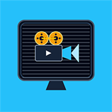
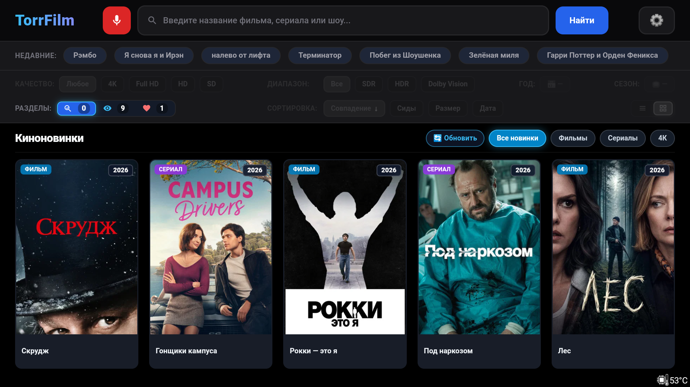
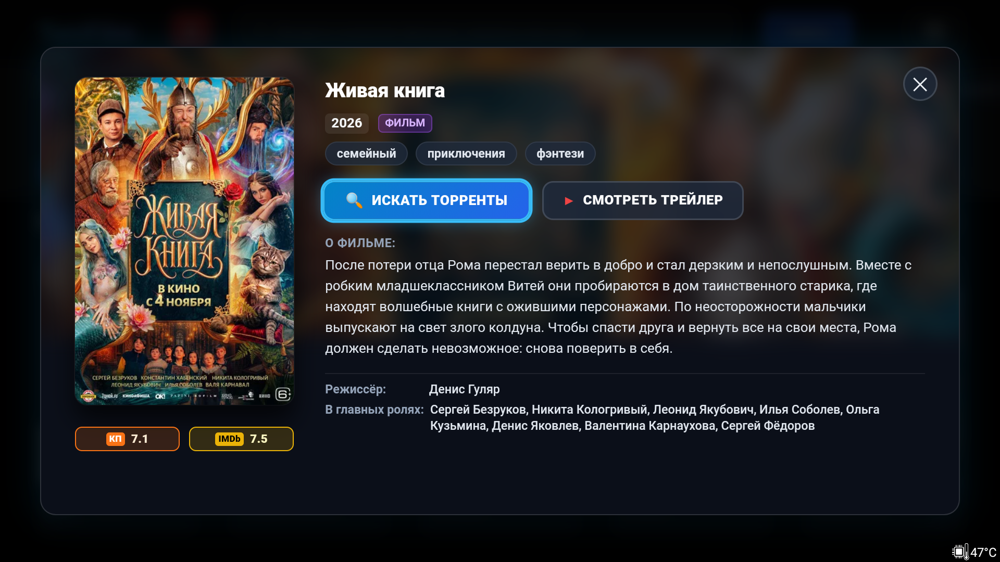
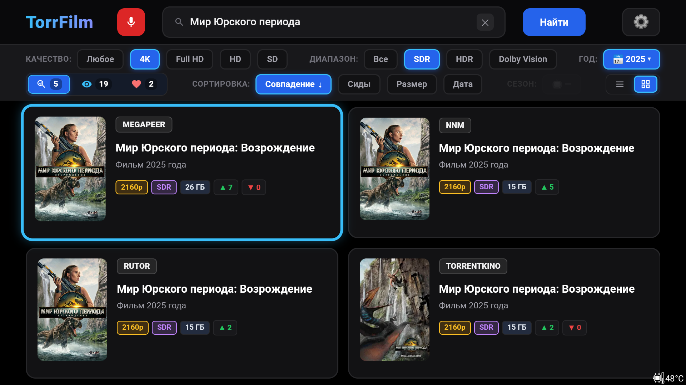
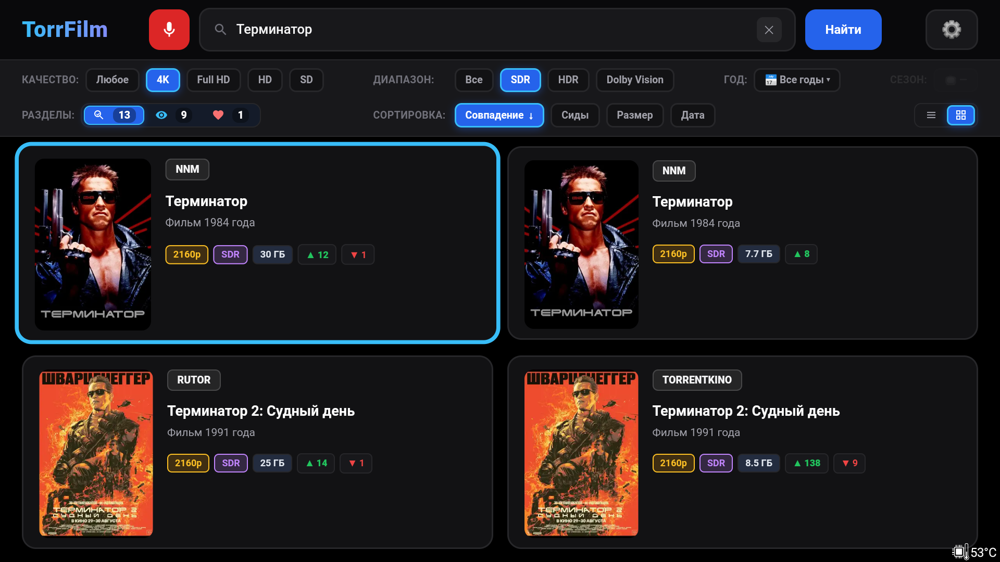
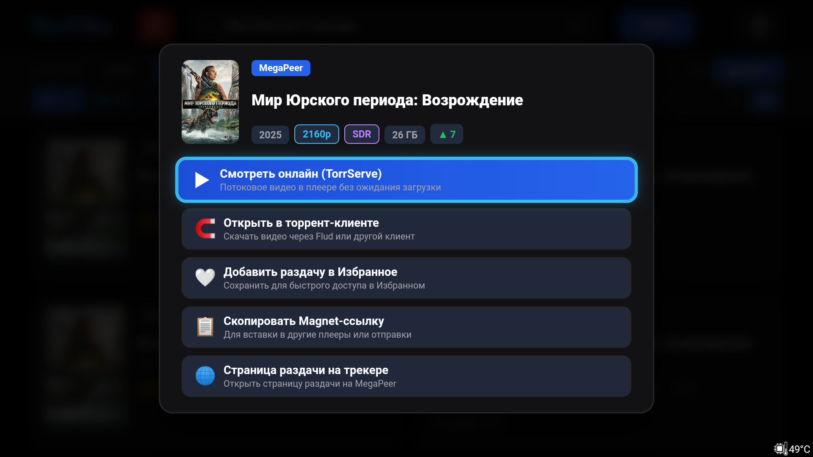
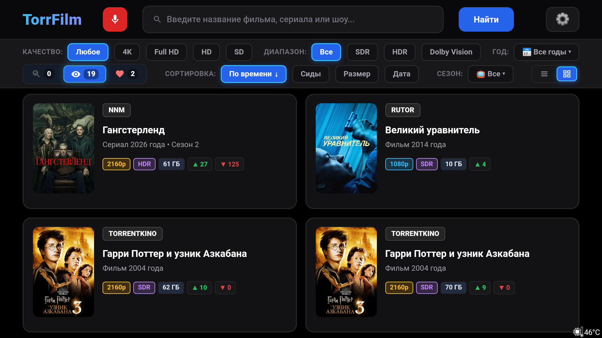
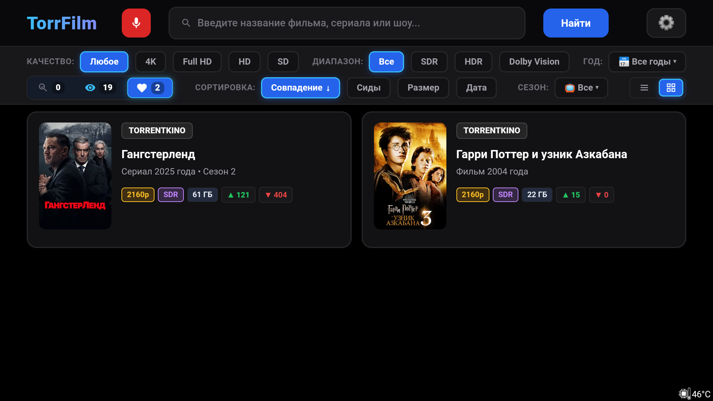
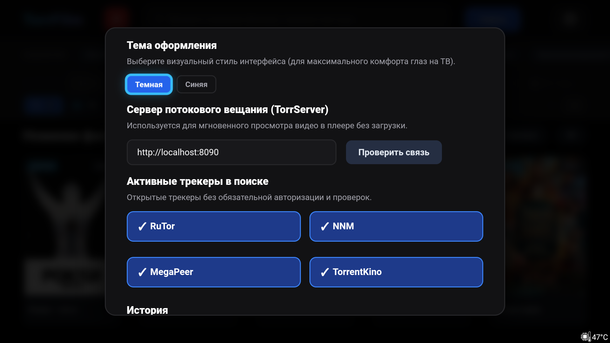

# TorrFilm (Android TV)

**Быстрый агрегатор и поисковик торрент-раздач для телевизоров, медиаприставок и проекторов на базе Android TV и Google TV.**

### 📥 [Скачать TorrFilm.apk (v1.0.3)](https://github.com/Yura1206/TorrFilm/releases/latest/download/TorrFilm.apk)
*(Прямая ссылка на загрузку актуальной версии)*

> 📦 **Предыдущие версии:** [TorrFilm v1.0.2](https://github.com/Yura1206/TorrFilm/releases/download/v1.0.2/TorrFilm.apk) *(архивные файлы APK также доступны в папке [`release/`](release/))*.

---

## 📺 О проекте

**TorrFilm** — специализированное приложение для комфортного поиска и онлайн-просмотра фильмов и сериалов с открытых торрент-трекеров на экранах телевизоров. 

Приложение изначально спроектировано для работы с пультом дистанционного управления (D-Pad), поддерживает голосовой ввод и связку с **TorrServe MatriX** для просмотра видеопотока без необходимости предварительного скачивания файлов на накопитель.

---

## 📸 Скриншоты интерфейса

### Главный экран: витрина «Киноновинки»

  

### Карточка фильма с рейтингами Кинопоиск, IMDb и описанием

  

### Главный экран с отключенным разделом киноновинок

  

### Результаты поиска в режиме «Сетка» (карточки с постерами)

  

### Результаты поиска в режиме «Список»

  

### Меню действий с раздачей (TorrServe MatriX, плееры, magnet)

  

### Настройки: темы оформления, раздел с новинками и TorrServer

  

### Настройки: активные трекеры, обход блокировок и управление историей

---

## 🛡️ Отказоустойчивый обход блокировок трекеров и постеров в РФ

В версии 1.0.3 реализована продвинутая система бесперебойного доступа к трекерам и метаданным в условиях сетевых ограничений и блокировок в РФ:

* **Многоуровневый каскад Edge-шлюзов с автоматическим переключением:**
  1. 🥇 **Основной:** *Cloudflare Workers Gateway* — высокоскоростной глобальный шлюз, стабильно работающий по всей территории РФ со временем отклика ~0.2 сек.
  2. 🥈 **Резервный:** *Supabase Edge Gateway (Франкфурт)* — европейский отказоустойчивый рубеж на случай сбоев.
  * *При сбое или блокировке текущего шлюза переключение на следующий происходит мгновенно и незаметно для пользователя.*
* **Отечественный каскад загрузки постеров:**
  * Интеллектуальный приоритет загрузки постеров с незаблокированных российских серверов: **Кинопоиск CDN (`avatars.mds.yandex.net`)**, **TorrentKino CDN** и **Кино Mail.ru (`resizer.mail.ru`)**. Постеры отображаются моментально без участия внешних прокси.
  * Если постер отсутствует на отечественных серверах, задействуется проксирование через активный Edge-шлюз.
* **Встроенная диагностика сети в настройках:**
  * Кнопка «Проверить доступность трекеров» тестирует всю цепочку соединений в строгом порядке их реального использования: *Кинопоиск CDN → TorrentKino CDN → Кино Mail.ru CDN → Cloudflare Gateway → Supabase Gateway → Прямой опрос трекеров*.
  * Наглядное уведомление подробно сообщает о статусе каждого шлюза и доступности раздач.

---

## ✨ Ключевые возможности

### 🧭 Разделы приложения
* **🔍 Найденное и витрина «Киноновинки»:**
  * **Витрина «Киноновинки»:** на главном экране отображаются свежие цифровые премьеры с фильтрами по категориям (*Все*, *Фильмы*, *Сериалы*, *4K UHD*). Автообновление каталога каждые 24 часа или вручную.
  * **Опция отключения витрины:** в настройках можно полностью отключить отображение «Киноновинок». При этом приложение полностью прекращает любые фоновые запросы и автообновления, экономя ресурсы ТВ-приставки.
  * **Карточка фильма/сериала:** подробное описание, постер высокого качества, фоновый арт (backdrop), жанры, год, длительность и рейтинги **Кинопоиск** и **IMDb** с кнопкой быстрого перехода к поиску раздач.
* **👁️ Просмотренное:** автоматическое сохранение раздач, запущенных через TorrServe MatriX. Позволяет легко продолжить просмотр сериала или фильма без повторного ввода названия.
* **❤️ Избранное:** локальные закладки для любимых релизов и отложенного просмотра.

### 🎮 Управление и поиск
* **Полная адаптация под пульт (D-Pad):** предсказуемая навигация стрелками, контрастное выделение активного фокуса, отсутствие сбивающихся скроллов.
* **Фиксация экрана при вводе с клавиатуры:** режим `adjustNothing` предотвращает любое сжатие, дергание или деформацию карточек результатов поиска при открытии экранной клавиатуры Android TV.
* **Идеальное выравнивание в режиме списка:** строго фиксированные размеры всех бейджей раздач гарантируют идеально ровные строки без смещений.
* **Голосовой поиск:** возможность надиктовать название фильма с микрофона пульта ДУ.
* **История поисковых запросов:** интерактивные «чипсы» последних поисков в шапке с быстрым перезапуском или удалением.
* **Стильная неоновая заглушка:** при пустом поиске отображается аккуратная векторная иконка с мягким свечением и центрированной подсказкой.

### 🎯 Локальная фильтрация и сортировка на лету
* **Разрешение видео:** 4K (2160p), Full HD (1080p), HD (720p), SD.
* **Динамический диапазон:** SDR, HDR, Dolby Vision (DV).
* **Год премьеры:** удобное меню выбора года среди реально найденных раздач.
* **Сезоны для сериалов:** умный фильтр сезонов активируется только тогда, когда в выдаче присутствуют многосерийные релизы.
* **Сортировка:** по соответствию поисковому запросу, количеству сидов (▲), размеру файла и дате публикации.

### 🎬 Интеграция с TorrServe MatriX и плеерами
* Запуск онлайн-просмотра в один клик через локальный или сетевой **TorrServe MatriX**.
* Поддержка популярных Android TV видеоплееров: **Vimu Media Player**, **Just Player**, **VLC**, **MX Player**, **Nova Video Player** и др.
* Возможность передачи magnet-ссылки во внешние торрент-клиенты (Flud, tTorrent и др.) или копирования ссылки.

### 📡 Поддерживаемые трекеры
* **RuTor** (открытый поиск, раздачи с пирами и прямыми magnet)
* **NNMClub** (открытый каталог релизов)
* **MegaPeer** (актуальные релизы фильмов и сериалов)
* **TorrentKino** (каталог с подробными метаданными)

---

## 📲 Установка на Android TV

1. Скачайте актуальный файл **[TorrFilm.apk](https://github.com/Yura1206/TorrFilm/releases/latest/download/TorrFilm.apk)**.
2. Перенесите файл на телевизор или медиаприставку удобным способом:
   * **Через USB-флешку:** скопируйте APK на накопитель и откройте любым файловым менеджером на ТВ (например, *X-plore* или *FX File Explorer*).
   * **Через Bluetooth:** отправьте APK-файл по Bluetooth со смартфона или планшета на телевизор.
   * **Через FTP / сетевой доступ CX Проводника:** включите сетевой доступ в CX Проводнике на ТВ и загрузите APK с телефона или с ПК через любой браузер прямо на ТВ.
   * **По локальной сети/Wi-Fi:** через приложение **Send Files to TV** (доступно в Google Play на телефоне и ТВ).
   * **Через приложение Downloader:** введите прямую ссылку на скачивание.
   * **Через ADB:** выполните команду `adb install TorrFilm.apk`.
3. При первой установке разрешите установку приложений из неизвестных источников в настройках безопасности Android TV.

---

## 🛠️ Системные требования

* **Платформа:** Android TV / Google TV / Android AOSP
* **Версия Android:** 6.0 (Marshmallow, API 23) и новее
* **Управление:** Пульт ДУ (D-Pad), аэромышь или клавиатура
* **Для онлайн-просмотра:** установленный и запущенный TorrServe MatriX (на том же ТВ, компьютере или роутере) и видеоплеер (рекомендуется Vimu или Just Player).

---

## ⚖️ Лицензия

Проект распространяется под свободной лицензией [MIT](LICENSE).
