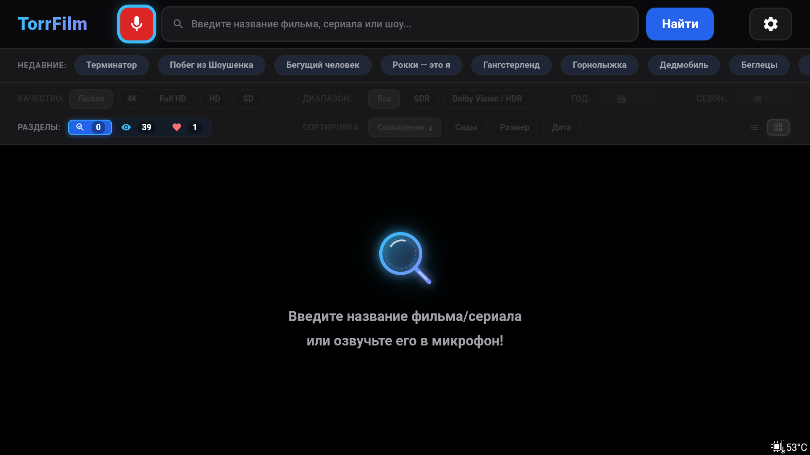
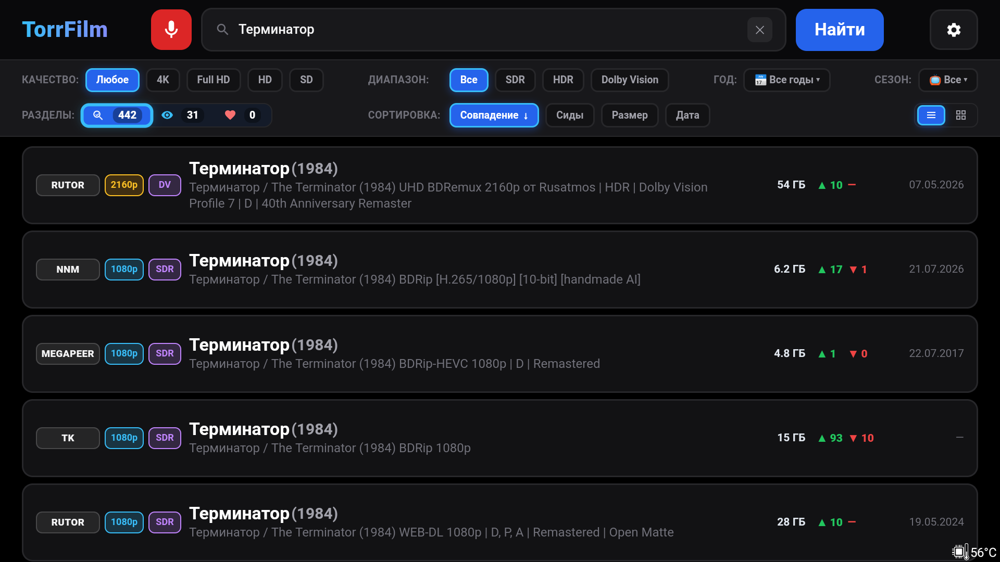
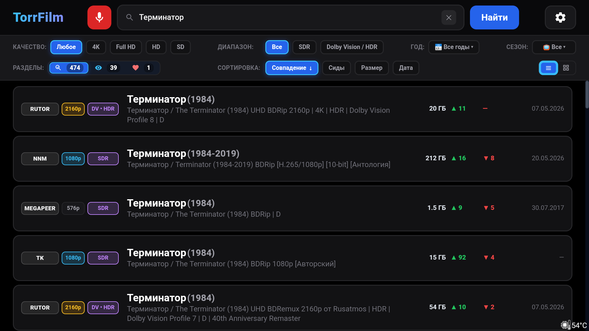
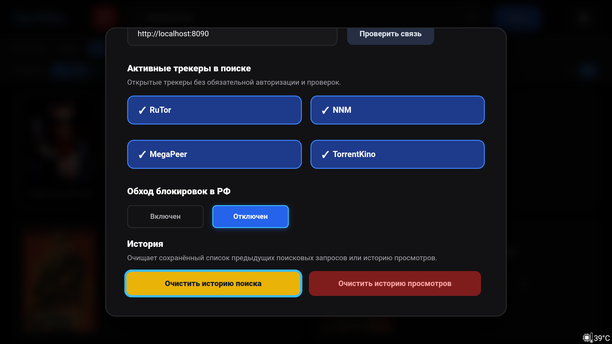
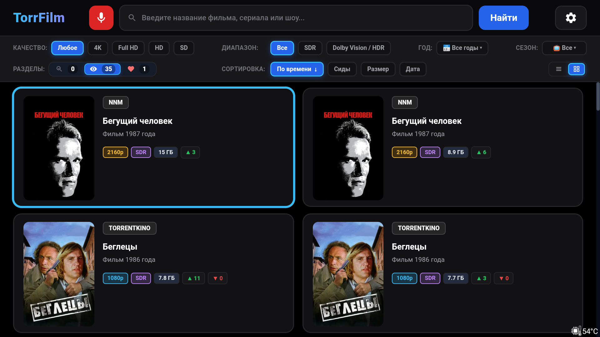
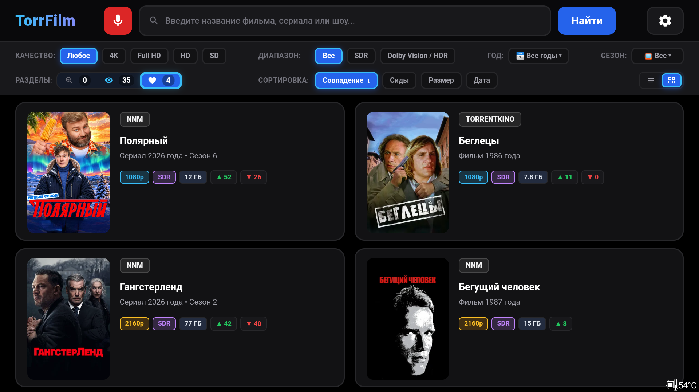
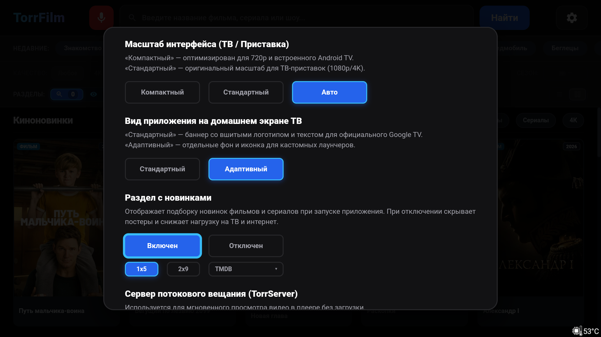
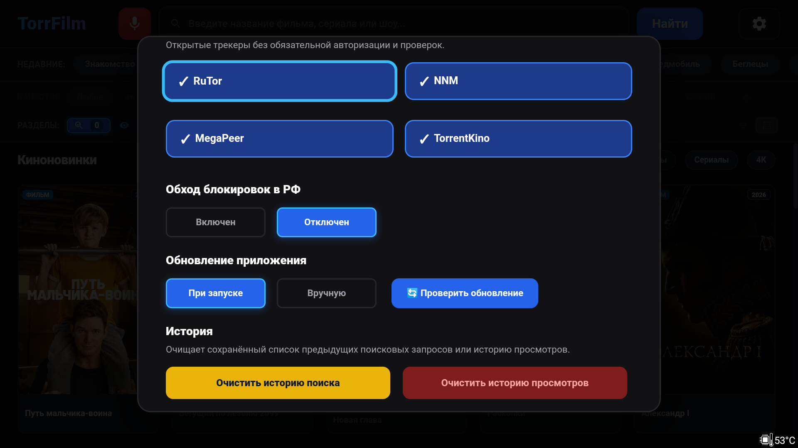
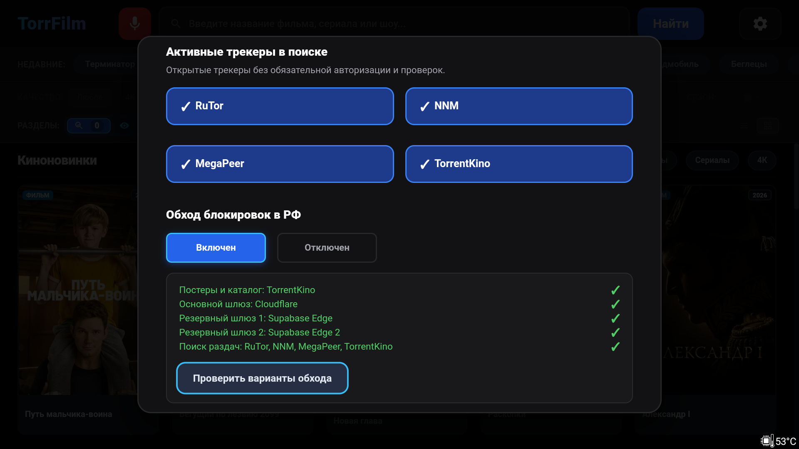
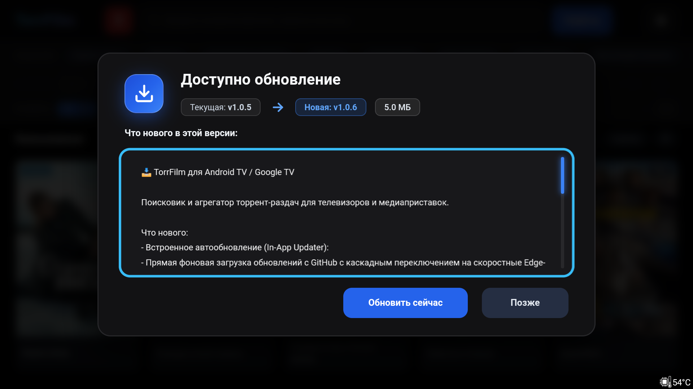

# TorrFilm (Android TV)

**Быстрый агрегатор и поисковик торрент-раздач для телевизоров, медиаприставок и проекторов на базе Android TV и Google TV.**

### 📥 [Скачать TorrFilm.apk (v1.0.6)](https://github.com/Yura1206/TorrFilm/releases/latest/download/TorrFilm.apk)
*(Прямая ссылка на загрузку актуальной версии)*

> **Примечание по Google Play Защита (Play Protect):**
> Из-за добавления встроенного модуля автообновления приложения **Google Play Защита** может отмечать `TorrFilm.apk` как потенциально опасное приложение и предупреждать при установке. На это предупреждение не стоит обращать внимания — оно связано исключительно с наличием механизма загрузки и установки обновлений внутри приложения. Программа полностью безопасна, её можно смело устанавливать («Подробнее» → «Всё равно установить»).

---

## 📺 О проекте

**TorrFilm** — специализированное приложение для комфортного поиска и онлайн-просмотра фильмов и сериалов с открытых торрент-трекеров на экранах телевизоров.

Приложение изначально спроектировано для работы с пультом дистанционного управления (D-Pad), поддерживает голосовой ввод и связку с **TorrServe MatriX** для просмотра видеопотока без необходимости предварительного скачивания файлов на накопитель.

---

## 🚀 Что нового в версии 1.0.6

* **🔄 Встроенный модуль автообновления (In-App Updater):**
  * Автоматическая проверка обновлений при запуске или ручная проверка в настройках.
  * Информативное окно обновления с номерами текущей и новой версий, размером файла, списком изменений и шкалой прогресса загрузки.
  * Прямая фоновая загрузка нового APK с GitHub с резервированием через быстрые Edge-шлюзы при сетевых ограничениях.
* **🎬 Компактный режим витрины «Киноновинки» (2×9) и настройки каталога:**
  * Добавлен режим отображения **2×9** (18 карточек новинок на одном экране) в дополнение к классическому крупному режиму **1×5**.
  * Выбор каталога новинок перенесён прямо в блок настроек «Раздел с новинками» для удобного переключения.
* **📜 Полосы прокрутки и удобное управление разделами:**
  * Добавлены наглядные вертикальные полосы прокрутки в списках раздач и окне настроек.
  * В разделе «Просмотренное» реализовано точечное удаление одной раздачи по длительному нажатию кнопки **ОК** — фокус сразу переходит на кнопку «Удалить» и корректно возвращается на карточку после закрытия меню.
  * Одинарное нажатие кнопки «Назад» в разделах «Просмотренное» и «Избранное» мгновенно возвращает на главный экран; двойное нажатие «Назад» на главном экране предлагает выйти из приложения.
* **⚡ Скорость работы, голосовой поиск и точный размер раздач:**
  * Ускорено выполнение поиска, запуск **TorrServe** и открытие модальных окон.
  * Улучшен голосовой поиск: предварительный прогрев микрофона и корректная отмена кнопкой «Назад».
  * Исправлено определение размера файлов для некоторых раздач с трекера MegaPeer.
* **🖥️ Полировка интерфейса 720p и навигации:**
  * Устранено подёргивание списка раздач при перемещении пульта по фильтрам в интерфейсе 720p.
  * Исправлена плавная прокрутка окна настроек до нижних пунктов с пульта ДУ.

<b>Предыдущие версии (v1.0.5, v1.0.4)</b>

### Версия 1.0.5
* **🎙️ Умное автоисправление и логика фокуса голосового поиска:** интеллектуальное исправление неточно распознанных голосовых запросов, нормализация кириллицы/латиницы, удержание фокуса на кнопке отмены поиска и автоматический переход фокуса на фильтр качества после загрузки раздач.
* **🎬 Плавная бесконечная подгрузка новинок:** упреждающая пакетная предзагрузка постеров на 15–20 карточек вперёд и мгновенное отображение витрины при запуске.
* **📖 Модальное окно синопсиса и карточка фильма:** кнопка подробного описания, предварительная загрузка жанров, рейтингов Кинопоиск/IMDb/TMDB, страны и длительности.
* **🛡️ 3-уровневый каскад Edge-шлюзов:** основной Cloudflare-шлюз + 2 резервных шлюза Supabase с мгновенным автоматическим переключением и расширенной диагностикой сети.

### Версия 1.0.4
* **🖥️ Поддержка 720p (HD) и переключение масштаба интерфейса:** режимы **«Авто»**, **«Компактный»** (720p) и **«Стандартный»** (1080p).
* **🏷️ Выбор вида приложения на домашнем экране ТВ:** **«Стандартный»** баннер 16:9 для Google TV / Android TV и **«Адаптивный»** для кастомных лаунчеров (Projectivy, ATV Launcher, FLauncher).
* **🌍 Отображение страны производства** в карточках новинок и окне подробной информации о раздаче.
* **⚡ Аппаратное ускорение** и нативная синхронизация голосового поиска.

---

## 📸 Скриншоты интерфейса

*(Нажмите на любой скриншот, чтобы открыть его в полном размере без сжатия)*

### 1. Главный экран: витрина «Киноновинки» (режим 1×5)

  

### 2. Витрина «Киноновинки» в компактном режиме 2×9

  

### 3. Карточка фильма с описанием, страной, длительностью и рейтингами (КП, IMDb, TMDB)

  

### 4. Главный экран с отключённой витриной новинок

  

### 5. Экран активного поиска по трекерам с кнопкой отмены

  

### 6. Результаты поиска в режиме «Сетка» (карточки с постерами)

  

### 7. Результаты поиска в режиме «Список»

  

### 8. Меню действий с раздачей (TorrServe, торрент-клиент, «Избранное», magnet-ссылка)

  

### 9. Раздел «Просмотренное» (история запущенных раздач)

  

### 10. Раздел «Избранное»

  

### 11. Настройки: масштаб экрана (720p / 1080p / Авто), значок лаунчера и режим витрины (1×5 / 2×9)

  

### 12. Настройки: активные трекеры, автообновление и очистка истории

  

### 13. Диагностика соединения и проверка доступности шлюзов и трекеров

  

### 14. Встроенное окно обновления приложения

---

## 🛡️ Отказоустойчивое решение для стабильного доступа к каталогам и постерам

В приложении реализована трёхуровневая архитектура для бесперебойного доступа к каталогам новинок, раздачам и постерам в любых сетевых условиях:

* **Трёхуровневый каскад Edge-шлюзов с автоматическим переключением:**
  1. 🥇 **Основной:** *Cloudflare Workers Gateway* (собственный выделенный домен) — высокоскоростной глобальный рубеж с минимальным временем отклика (~0.2 сек).
  2. 🥈 **Резервный 1:** *Supabase Edge Gateway #1 (Франкфурт)* — европейский изолированный рубеж, автоматически принимающий запросы при недоступности основного шлюза.
  3. 🥉 **Резервный 2:** *Supabase Edge Gateway #2* — дополнительный независимый резервный шлюз для стабильной работы при сбоях у магистральных провайдеров.
  * *Переключение между шлюзами происходит моментально и полностью прозрачно для пользователя.*

* **Выбор источника каталога новинок и прямая загрузка постеров:**
  * В настройках доступен выбор источника цифровых премьер и постеров среди открытых каталогов (включая **TMDB** и альтернативные каталоги).
  * Постеры и метаданные загружаются напрямую с быстрых серверов, обеспечивая плавное пролистывание даже в компактном режиме `2×9`.

* **Интерактивная диагностика в настройках:**
  * Встроенный инструмент тестирует всю рабочую цепочку в реальном времени: доступность каталога и постеров, основной и резервные шлюзы, а также опрос всех выбранных трекеров.

---

## ✨ Ключевые возможности

### 🧭 Разделы приложения
* **🔍 Найденное и витрина «Киноновинки»:**
  * **Витрина «Киноновинки»:** свежие цифровые премьеры с фильтрами (*Все новинки*, *Фильмы*, *Сериалы*, *4K*), переключением сетки (`1×5` или `2×9`) и автообновлением каталога.
  * **Опция отключения витрины:** в настройках можно полностью отключить «Киноновинки», экономя ресурсы ТВ-приставки.
  * **Карточка фильма/сериала:** описание, постер высокого качества, жанры, страна, длительность, режиссёр, актёры, рейтинги **Кинопоиск**, **IMDb** и **TMDB**, кнопки поиска торрентов и просмотра трейлера.
* **👁️ Просмотренное:** автоматическое сохранение раздач, запущенных через TorrServe MatriX, с возможностью быстрого удаления отдельной записи.
* **❤️ Избранное:** локальные закладки для любимых релизов и отложенного просмотра.

### 🎮 Управление, адаптация и поиск
* **Выбор разрешения и масштаба экрана:** нативная поддержка экранов 1080p (Full HD / 4K) и 720p (HD) с автоматическим определением или ручным переключением в настройках (*Авто* / *Компактный* / *Стандартный*).
* **Вид приложения на домашнем экране:** выбор между стандартным баннером 16:9 для официального Android TV и адаптивным значком для кастомных лаунчеров (Projectivy, ATV Launcher и др.).
* **Полная адаптация под пульт (D-Pad):** предсказуемая навигация стрелками, контрастное выделение фокуса, наглядные полосы прокрутки и быстрый возврат по кнопке «Назад».
* **Голосовой поиск:** быстрый прогрев микрофона и нативная синхронизация со звуковым сигналом пульта.
* **История поисковых запросов:** интерактивные подсказки недавних поисков в шапке с быстрым перезапуском.

### 🎯 Локальная фильтрация и сортировка на лету
* **Разрешение видео:** 4K (2160p), Full HD (1080p), HD (720p), SD.
* **Динамический диапазон:** SDR, HDR, Dolby Vision (DV).
* **Год и сезон:** удобные выпадающие списки года и сезона для сериалов среди найденных раздач.
* **Сортировка:** по соответствию запросу, количеству сидов (▲), размеру файла и дате публикации.

### 🎬 Интеграция с TorrServe MatriX и плеерами
* Запуск онлайн-просмотра в один клик через локальный или сетевой **TorrServe MatriX**.
* Поддержка популярных Android TV видеоплееров: **Vimu Media Player**, **Just Player**, **VLC**, **MX Player**, **Nova Video Player** и др.
* Передача magnet-ссылки во внешние торрент-клиенты (Flud, tTorrent и др.) или копирование ссылки.

### 📡 Поддерживаемые источники
* **Параллельный опрос популярных открытых каталогов:** RuTor, NNM, MegaPeer, TorrentKino.
* **Умная агрегация выдачи:** объединение результатов, удаление дубликатов и гибкое включение/отключение отдельных трекеров в настройках.

---

## 📲 Установка на Android TV

1. Скачайте актуальный файл **[TorrFilm.apk](https://github.com/Yura1206/TorrFilm/releases/latest/download/TorrFilm.apk)**.
2. Перенесите файл на телевизор или медиаприставку удобным способом:
   * **Через USB-флешку:** скопируйте APK на накопитель и откройте любым файловым менеджером на ТВ (*X-plore*, *FX File Explorer*, *CX Проводник*).
   * **По локальной сети / Wi-Fi:** через приложение **Send Files to TV** или сетевой доступ **CX Проводника**.
   * **Через приложение Downloader:** введите прямую ссылку на скачивание.
   * **Через ADB:** выполните команду `adb install TorrFilm.apk`.
3. При первой установке разрешите установку приложений из неизвестных источников в настройках безопасности Android TV.
4. Если **Google Play Защита** покажет предупреждение из-за встроенного модуля обновления, нажмите **«Подробнее» → «Всё равно установить»** — это безопасно.

---

## 🛠️ Системные требования

* **Платформа:** Android TV / Google TV / Android AOSP
* **Версия Android:** 6.0 (Marshmallow, API 23) и новее
* **Управление:** Пульт ДУ (D-Pad), аэромышь или клавиатура
* **Для онлайн-просмотра:** установленный и запущенный **TorrServe MatriX** (на том же ТВ, компьютере или роутере) и видеоплеер (рекомендуется Vimu или Just Player).

---

## ⚖️ Лицензия

Проект распространяется под свободной лицензией [MIT](LICENSE).
